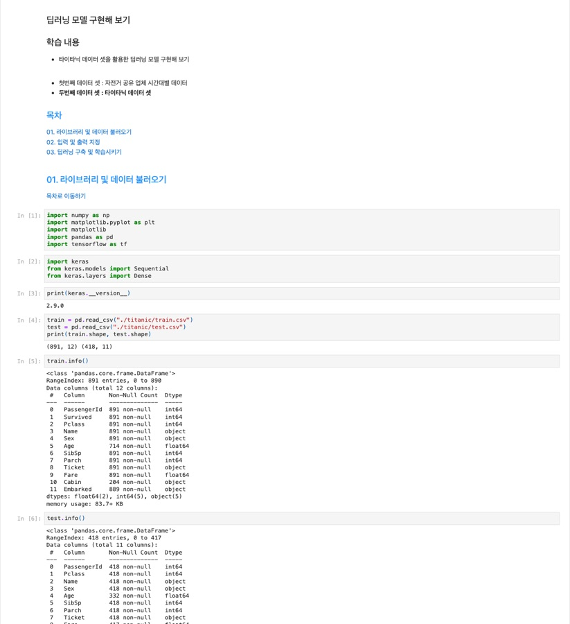
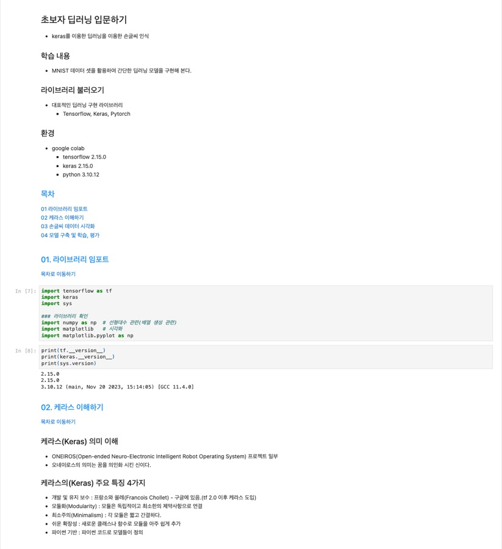
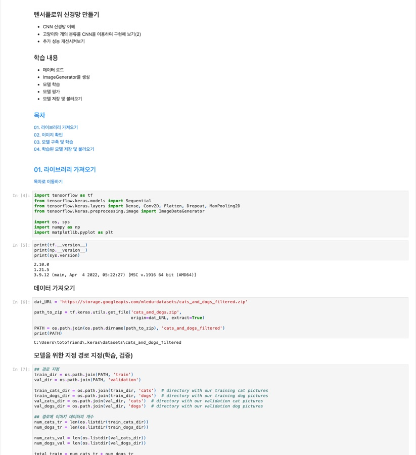
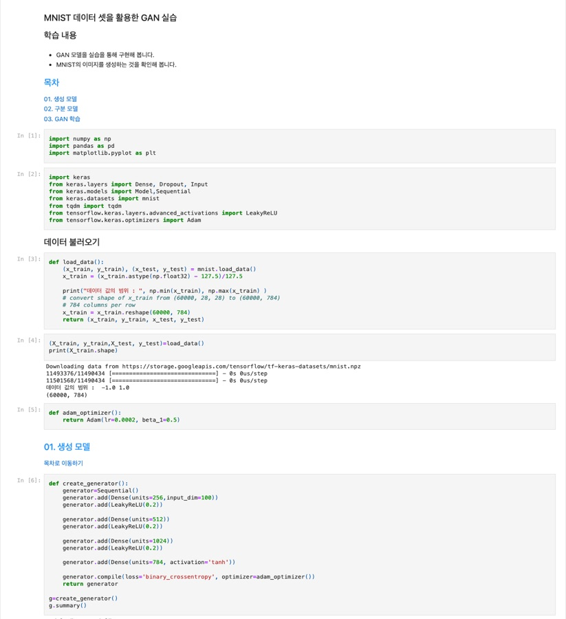
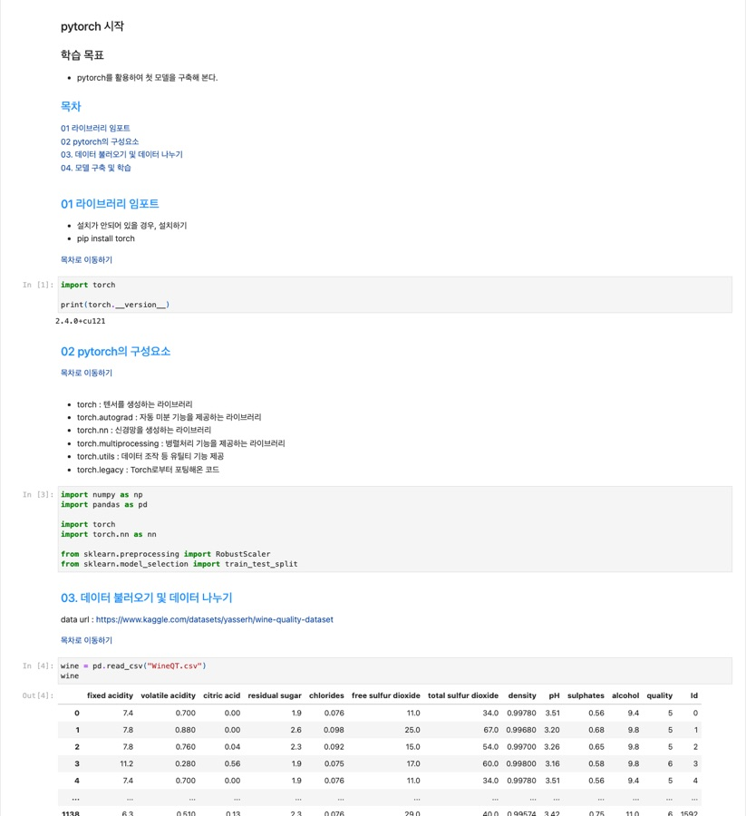
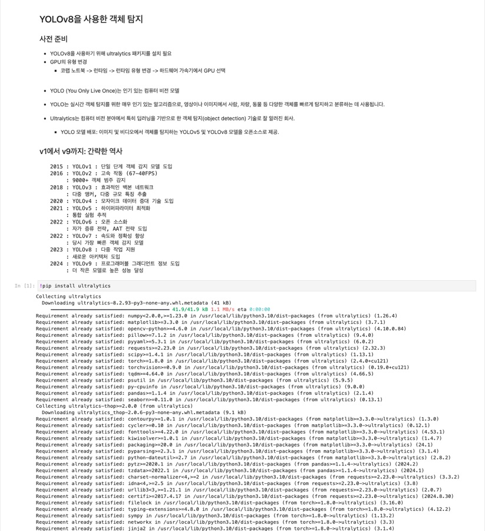

🇰🇷 [한국어](README.md) · 🇺🇸 **English** · 🇯🇵 [日本語](README.ja.md)

# DL_Basic — Intro to Deep Learning Course Materials

A warm welcome to everyone who stops by! 👍 If you find this helpful, please don't just leave~~
Hitting the **'Star' button at the top right** would mean a lot to me.^^

From an introduction to deep learning through MNIST, CNNs, RNNs, GANs, transfer learning (YOLO), hands-on PyTorch, and Kaggle competitions,
this is a course library built with two frameworks: **TensorFlow/Keras** and **PyTorch**. The practice notebooks are published as HTML and PDF so anyone can open them right away.

> **Note:** All slides and notebooks (PDF/HTML) are written in **Korean**. The code runs the same in any language, and your browser's built-in translation (e.g. Chrome) works on the HTML pages.

**Web page**: [https://ldjwj.github.io/DL_Basic/README.en.html](https://ldjwj.github.io/DL_Basic/README.en.html) — Browse every material directly on GitHub Pages.

---

## Table of Contents

- [Quick Start](#quick-start)
- [1. Deep Learning Fundamentals](#1-deep-learning-fundamentals)
- [2. Practice Code and Notion](#2-practice-code-and-notion)
- [3. Getting Started with Deep Learning](#3-getting-started-with-deep-learning)
- [4. MNIST Image Classification](#4-mnist-image-classification)
- [5. Movie Review and News Classification](#5-movie-review-and-news-classification)
- [6. CNN Image Classification](#6-cnn-image-classification)
- [7. Dogs vs Cats Classification](#7-dogs-vs-cats-classification)
- [8. TensorFlow 2.x Practice](#8-tensorflow-2x-practice)
- [9. PyTorch Practice](#9-pytorch-practice)
- [10. Natural Language Processing](#10-natural-language-processing)
- [11. RNNs (Recurrent Neural Networks)](#11-rnns-recurrent-neural-networks)
- [12. GAN](#12-gan)
- [13. Transfer Learning, Object Detection, OCR](#13-transfer-learning-object-detection-ocr)
- [14. Kaggle in Practice](#14-kaggle-in-practice)
- [Featured Labs Preview](#featured-labs-preview)
- [References](#references)

---

## Quick Start

1. **Pick a framework.** Decide which stack you want to start deep learning with.
   - **TensorFlow/Keras** → Deep learning basics · MNIST · CNN · RNN · GAN (part 04)
   - **PyTorch** → Tensors · building models · linear regression · Wine · Kaggle (part 06)
2. **Set up your environment.** (takes about 5 minutes)
   - Windows: [TensorFlow 2.9 setup PDF](https://ldjwj.github.io/DL_Basic/딥러닝기본_DL01A_딥러닝기본환경만들기_tf29_window.pdf) · [Setup manual (HTML)](https://ldjwj.github.io/DL_Basic/딥러닝_기본_환경_만들기_window_3_8_13(tf2.9).html)
   - macOS: [TensorFlow 2.9 setup PDF](https://ldjwj.github.io/DL_Basic/딥러닝기본_DL01A_딥러닝기본환경만들기_tf29_mac.pdf)
3. **Run your first lab.**
   - Run it right away in Google Colab → [`part01_dl_basic_V10_2510.ipynb`](https://github.com/LDJWJ/DL_Basic/blob/main/class_code/part01_dl_basic_V10_2510.ipynb)
     
   - Or go through [Getting started with numpy · Keras](https://ldjwj.github.io/DL_Basic/part04_01_dl_start/ch01_02_KerasStart_numpy_2211.html) → [Titanic lab](https://ldjwj.github.io/DL_Basic/part04_01_dl_start/ch01_03_Neural_Net_Titanic_2207.html) in that order

> **Status legend**
> ✅ Recommended (latest version) · ⚠️ Older version, for reference · 🚧 Needs re-testing (versions need updating)

---

## 1. Deep Learning Fundamentals

### Main Lecture PDFs

| Material | Format | Status |
|:---|:---:|:---:|
| AI Ethics (DL00) | [PDF](https://ldjwj.github.io/DL_Basic/딥러닝기본_DL00_AI윤리_v10.pdf) | ✅ |
| Dev environment setup (Windows, TF 2.9) | [PDF](https://ldjwj.github.io/DL_Basic/딥러닝기본_DL01A_딥러닝기본환경만들기_tf29_window.pdf) | ✅ |
| Dev environment setup (macOS, TF 2.9) | [PDF](https://ldjwj.github.io/DL_Basic/딥러닝기본_DL01A_딥러닝기본환경만들기_tf29_mac.pdf) | ✅ |
| Dev environment setup (Windows, TF 2.6, older) | [PDF](https://ldjwj.github.io/DL_Basic/딥러닝기본_DL01A_딥러닝기본환경만들기_tf26.pdf) | ⚠️ |
| Getting started with deep learning (v13, 2023.05) | [PDF](https://ldjwj.github.io/DL_Basic/딥러닝기본_DL01_딥러닝입문_v13_2305.pdf) | ✅ |
| Deep learning terminology (v11, 2022.07) | [PDF](https://ldjwj.github.io/DL_Basic/딥러닝기본_DL02_딥러닝기본용어_v11_2207.pdf) | ✅ |
| Deep learning basics (v12, 2022.07) | [PDF](https://ldjwj.github.io/DL_Basic/딥러닝기본_DL02_딥러닝기본_v12_2207.pdf) | ✅ |
| Getting started with CNNs (algorithm v11) | [PDF](https://ldjwj.github.io/DL_Basic/딥러닝기본_DL03_CNN01_알고리즘_v11.pdf) | ✅ |
| Upgrading CNNs (model improvements, 2207) | [PDF](https://ldjwj.github.io/DL_Basic/딥러닝입문_DL03_CNN03_모델UP_2207_v02.pdf) | ✅ |
| Intro to TensorFlow (TF 2.0, 2002) | [PDF](https://ldjwj.github.io/DL_Basic/딥러닝기본_DL04_tf2.0소개_2002_v02.pdf) | ⚠️ |
| Model improvement (Dropout) | [PDF](https://ldjwj.github.io/DL_Basic/part04_07_dl_tf2x_modelUp/DL03_02_DROPOUT.pdf) | ✅ |
| Intro to GANs (202011) | [PDF](https://ldjwj.github.io/DL_Basic/딥러닝입문_DL04_기본_GAN_202011_v05.pdf) | ✅ |
| Intro to RNNs | [PDF](https://ldjwj.github.io/DL_Basic/딥러닝입문_DL05_기본_RNN_v11.pdf) | ✅ |
| Introduction to YOLO | [PDF](https://ldjwj.github.io/DL_Basic/part06_02_ocr_yolo_resnet/Yolo_Intro_V12.pdf) | ✅ |

> A note on RNNs: As of September 2024, Transformer models have replaced much of their role in areas such as natural language processing. Even so, RNNs are expected to remain important in fields like time-series forecasting and speech recognition.

### Older Versions · Reference PDFs

| Material | Format | Status |
|:---|:---:|:---:|
| Intro to deep learning (v10, 2021.11) | [PDF](https://ldjwj.github.io/DL_Basic/01C_딥러닝입문_v10_2111.pdf) | ⚠️ |
| Intro to deep learning (v12, 2022.12) | [PDF](https://ldjwj.github.io/DL_Basic/딥러닝기본_DL01B_딥러닝입문_v12_2212.pdf) | ⚠️ |
| CNN algorithms (v02, 2022.05) | [PDF](https://ldjwj.github.io/DL_Basic/딥러닝기본_DL03_CNN01_알고리즘_v02_2205.pdf) | ⚠️ |
| CNN algorithms (v10) | [PDF](https://ldjwj.github.io/DL_Basic/딥러닝기본_DL03_CNN01_알고리즘_v10.pdf) | ⚠️ |
| CNN algorithms (v02, 2022.05) | [PDF](https://ldjwj.github.io/DL_Basic/딥러닝기본_DL03_CNN02_알고리즘_v02_2205.pdf) | ⚠️ |

---

## 2. Practice Code and Notion

- Deep learning basics & practice **Notion study page**: [Link](https://www.notion.so/_GP510-2817d480b593802bbf3ec228ad2cafc4?source=copy_link)
- Practice code (`class_code/part01_dl_basic_V10_2510.ipynb`):
  

---

## 3. Getting Started with Deep Learning

| Material | Format | Status |
|:---|:---:|:---:|
| Python built-in functions & core libraries | [HTML](https://ldjwj.github.io/DL_Basic/part04_01_dl_start/ch01_01_Python_Library_V10_2211.html) · [PDF](https://ldjwj.github.io/DL_Basic/part04_01_dl_start/ch01_01_Python_Library_V10_2211.pdf) | ✅ |
| numpy basics · getting started with Keras | [HTML](https://ldjwj.github.io/DL_Basic/part04_01_dl_start/ch01_02_KerasStart_numpy_2211.html) · [PDF](https://ldjwj.github.io/DL_Basic/part04_01_dl_start/ch01_02_KerasStart_numpy_2211.pdf) | ✅ |
| Bike Sharing Demand (regression) | [HTML](https://ldjwj.github.io/DL_Basic/part04_01_dl_start/ch01_02_Neural_Net_Bike_2211.html) · [PDF](https://ldjwj.github.io/DL_Basic/part04_01_dl_start/ch01_02_Neural_Net_Bike_2211.pdf) | ✅ |
| Titanic (classification) | [HTML](https://ldjwj.github.io/DL_Basic/part04_01_dl_start/ch01_03_Neural_Net_Titanic_2207.html) · [PDF](https://ldjwj.github.io/DL_Basic/part04_01_dl_start/ch01_03_Neural_Net_Titanic_2207.pdf) | ✅ |
| Titanic with PyTorch (2411) | [HTML](https://ldjwj.github.io/DL_Basic/part04_01_dl_start/ch01_03_NNet_Titanic_pytorch_V01_2411.html) · [PDF](https://ldjwj.github.io/DL_Basic/part04_01_dl_start/ch01_03_NNet_Titanic_pytorch_V01.pdf) | ✅ |

---

## 4. MNIST Image Classification

| Material | Format | Status |
|:---|:---:|:---:|
| MNIST 01 — first model (WC) | [HTML](https://ldjwj.github.io/DL_Basic/part04_02_dl_mnist/ch01_04_02_DL_mnist01_firstmodel_WC_V11.html) · [PDF](https://ldjwj.github.io/DL_Basic/part04_02_dl_mnist/ch01_04_02_DL_mnist01_firstmodel_WC_V11.pdf) | ✅ |
| MNIST 02 — boosting model performance | [HTML](https://ldjwj.github.io/DL_Basic/part04_02_dl_mnist/ch01_04_02_DL_mnist02_up_2207.html) · [PDF](https://ldjwj.github.io/DL_Basic/part04_02_dl_mnist/ch01_04_02_DL_mnist02_up_2207.pdf) | ✅ |
| MNIST 03 — performance improvements | [HTML](https://ldjwj.github.io/DL_Basic/part04_02_dl_mnist/ch01_04_03_DL_mnist03_up_2207.html) · [PDF](https://ldjwj.github.io/DL_Basic/part04_02_dl_mnist/ch01_04_03_DL_mnist03_up_2207.pdf) | ✅ |
| MNIST 04 — EarlyStopping | [HTML](https://ldjwj.github.io/DL_Basic/part04_02_dl_mnist/ch01_04_04_DL_mnist04_EarlyStop_2207.html) · [PDF](https://ldjwj.github.io/DL_Basic/part04_02_dl_mnist/ch01_04_04_DL_mnist04_EarlyStop_2207.pdf) | ✅ |

---

## 5. Movie Review and News Classification

| Material | Format | Status |
|:---|:---:|:---:|
| Movie review sentiment classification (IMDB) | [HTML](https://ldjwj.github.io/DL_Basic/part04_03_dl_pratice/ch03_01_01_movie_imdb_classification_2208.html) · [PDF](https://ldjwj.github.io/DL_Basic/part04_03_dl_pratice/ch03_01_01_movie_imdb_classification_2208.pdf) | ✅ |
| News article classification | [HTML](https://ldjwj.github.io/DL_Basic/part04_03_dl_pratice/ch03_05_01_news_classification_2205.html) · [PDF](https://ldjwj.github.io/DL_Basic/part04_03_dl_pratice/ch03_05_01_news_classification_2205.pdf) | ✅ |

---

## 6. CNN Image Classification

| Material | Format | Status |
|:---|:---:|:---:|
| CNN FirstModel (LAB01) | [HTML](https://ldjwj.github.io/DL_Basic/part04_04_dl_cnn_01/ch05_01_LAB01_CNN_A1_V11.html) · [PDF](https://ldjwj.github.io/DL_Basic/part04_04_dl_cnn_01/ch05_01_LAB01_CNN_A1_V11.pdf) | ✅ |
| CNN SecondModel (LAB02) | [HTML](https://ldjwj.github.io/DL_Basic/part04_04_dl_cnn_01/ch05_02_keras_LAB02_CNN_A2_2211.html) · [PDF](https://ldjwj.github.io/DL_Basic/part04_04_dl_cnn_01/ch05_01_Keras_LAB02_CNN_A2_2211.pdf) | ✅ |
| CNN, based on cs231n | [HTML](https://ldjwj.github.io/DL_Basic/part04_04_dl_cnn_02/ch05_04_CNN_D_add_cs231n.html) | ✅ |
| CNN Upgrade — LeakyReLU (LAB03) | [HTML](https://ldjwj.github.io/DL_Basic/part04_04_dl_cnn_01/ch05_02_keras_LAB03_CNN_add_B1.html) · [PDF](https://ldjwj.github.io/DL_Basic/part04_04_dl_cnn_01/ch05_02_keras_LAB03_CNN_add_B1.pdf) | ✅ |
| CNN Conv3 (LAB04) | [HTML](https://ldjwj.github.io/DL_Basic/part04_04_dl_cnn_01/ch05_02_keras_LAB04_CNN_add_B2.html) · [PDF](https://ldjwj.github.io/DL_Basic/part04_04_dl_cnn_01/ch05_02_keras_LAB04_CNN_add_B2.pdf) | ✅ |
| Dogs vs Cats (local) | [HTML](https://ldjwj.github.io/DL_Basic/part04_06_dl_tf2x/ch05_11_tf2x_CNN_CatvsDogs(1)_wlocal_2211.html) · [PDF](https://ldjwj.github.io/DL_Basic/ch05_11_tf2x_CNN_CatvsDogs(1)_wlocal_2211.pdf) | ✅ |
| CIFAR-10 (1) | [HTML](https://ldjwj.github.io/DL_Basic/part04_06_dl_tf2x/ch05_03_tf2x_LAB07_CNN_cifar10_2211.html) · [PDF](https://ldjwj.github.io/DL_Basic/part04_06_dl_tf2x/ch05_03_tf2x_LAB07_CNN_cifar10_2211.pdf) | ✅ |
| CIFAR-10 (3) — saving the model | [.py](https://github.com/LDJWJ/DL_Basic/blob/main/part05_01_flask/model_cifar.py) | ✅ |

---

## 7. Dogs vs Cats Classification

| Material | Format | Status |
|:---|:---:|:---:|
| CNN on Colab (V10, 2411) | [HTML](https://ldjwj.github.io/DL_Basic/part04_05_dl_cnn_catvsdog/ch05_07_CNN_CatvsDogs(1)_wcolab_V10_2411.html) · [PDF](https://ldjwj.github.io/DL_Basic/part04_05_dl_cnn_catvsdog/ch05_07_CNN_CatvsDogs(1)_wcolab_V10_2411.pdf) | ✅ |
| CNN on Colab — PyTorch (V10) | [HTML](https://ldjwj.github.io/DL_Basic/part04_05_dl_cnn_catvsdog/ch05_07_CNN_CatvsDogs(1)_PyTorch_V10_2411.html) · [PDF](https://ldjwj.github.io/DL_Basic/part04_05_dl_cnn_catvsdog/ch05_07_CNN_CatvsDogs(1)_PyTorch_V10_2411.pdf) | ✅ |
| CNN Kaggle notebook — baseline model | [HTML](https://ldjwj.github.io/DL_Basic/part04_05_dl_cnn_catvsdog/ch05_07_CNN_catvsdogs_withkaggle(1).html) · [PDF](https://ldjwj.github.io/DL_Basic/part04_05_dl_cnn_catvsdog/ch05_07_CNN_catvsdogs_withkaggle(1).pdf) | 🚧 |
| CNN (2) — image generator | [HTML](https://ldjwj.github.io/DL_Basic/part04_05_dl_cnn_catvsdog/ch05_07_CNN_CatvsDogs(2)_wcolab_2207.html) · [PDF](https://ldjwj.github.io/DL_Basic/part04_05_dl_cnn_catvsdog/ch05_07_CNN_CatvsDogs(2)_wcolab_2207.pdf) | 🚧 |
| CNN (3) — VGG16 | [HTML](https://ldjwj.github.io/DL_Basic/part04_05_dl_cnn_catvsdog/ch05_07_VGG_CatvsDogs(3)_wColab_2207.html) · [PDF](https://ldjwj.github.io/DL_Basic/part04_05_dl_cnn_catvsdog/ch05_07_VGG_CatvsDogs(3)_wColab_2207.pdf) | 🚧 |
| CNN (4) — VGG16 | [HTML](https://ldjwj.github.io/DL_Basic/part04_05_dl_cnn_catvsdog/ch05_07_VGG_CatvsDogs(4)_wcolab_2207.html) · [PDF](https://ldjwj.github.io/DL_Basic/part04_05_dl_cnn_catvsdog/ch05_07_VGG_CatvsDogs(4)_wcolab_2207.pdf) | 🚧 |

> Materials (2), (3), and (4) above need version updates and may not run on older versions. (as of Nov 2024)

---

## 8. TensorFlow 2.x Practice

| Material | Format | Status |
|:---|:---:|:---:|
| MNIST — getting started with TF 2.0 | [HTML](https://ldjwj.github.io/DL_Basic/part04_06_dl_tf2x/ch05_09_tf20_start.html) · [PDF](https://ldjwj.github.io/DL_Basic/part04_06_dl_tf2x/ch05_09_tf20_start.pdf) | ✅ |
| Fashion MNIST — DNN | [HTML](https://ldjwj.github.io/DL_Basic/part04_06_dl_tf2x/ch05_10_fashionMNIST01_DNN_2211.html) · [PDF](https://ldjwj.github.io/DL_Basic/part04_06_dl_tf2x/ch05_10_fashionMNIST01_DNN_2211.pdf) | ✅ |
| Fashion MNIST — CNN | [HTML](https://ldjwj.github.io/DL_Basic/part04_06_dl_tf2x/ch05_10_fashionMNIST02_CNN_2211.html) · [PDF](https://ldjwj.github.io/DL_Basic/part04_06_dl_tf2x/ch05_10_fashionMNIST02_CNN_2211.pdf) | ✅ |
| Kaggle — Dogs vs Cats | [HTML](https://ldjwj.github.io/DL_Basic/part04_06_dl_tf2x/ch05_11_tf20_CatsandDog(2)_onkaggle.html) · [PDF](https://ldjwj.github.io/DL_Basic/part04_06_dl_tf2x/ch05_11_tf20_CatsandDog(2)_onkaggle.pdf) | ✅ |

---

## 9. PyTorch Practice

| Material | Format | Status |
|:---|:---:|:---:|
| Understanding tensors & basic functions | [HTML](https://ldjwj.github.io/DL_Basic/part06_01_pytorch/ch01_01_pytorch_tensor_V10_colab.html) · [PDF](https://ldjwj.github.io/DL_Basic/part06_01_pytorch/ch01_01_pytorch_tensor_V10_colab.pdf) | ✅ |
| Building a deep learning model | [HTML](https://ldjwj.github.io/DL_Basic/part06_01_pytorch/ch01_02_pytorch_start_colab_V10.html) · [PDF](https://ldjwj.github.io/DL_Basic/part06_01_pytorch/ch01_02_pytorch_start_colab_V10.pdf) | ✅ |
| Linear regression basics | [HTML](https://ldjwj.github.io/DL_Basic/part06_01_pytorch/ch01_03_pytorch_LinearRegression_wc_V10.html) · [PDF](https://ldjwj.github.io/DL_Basic/part06_01_pytorch/ch01_03_pytorch_LinearRegression_wc_V10.pdf) | ✅ |
| Building a deep learning model for Wine | [HTML](https://ldjwj.github.io/DL_Basic/part06_01_pytorch/ch01_04_pytorch_wine_v10_colab.html) · [PDF](https://ldjwj.github.io/DL_Basic/part06_01_pytorch/ch01_04_pytorch_wine_v10_colab.pdf) | ✅ |
| Building a deep learning model for Titanic | [HTML](https://ldjwj.github.io/DL_Basic/part06_01_pytorch/ch01_03_PyTorch_Simple_wColab_V01_2411.html) · [PDF](https://ldjwj.github.io/DL_Basic/part06_01_pytorch/ch01_03_PyTorch_Simple_wColab_V01_2411.pdf) | ✅ |
| Building a deep learning model for Fashion MNIST | [HTML](https://ldjwj.github.io/DL_Basic/part06_01_pytorch/ch01_05_pt_fashionMnist_V10_wc.html) · [PDF](https://ldjwj.github.io/DL_Basic/part06_01_pytorch/ch01_05_pt_fashionMnist_V10_wc.pdf) | ✅ |
| RNN basics | [HTML](https://ldjwj.github.io/DL_Basic/part06_01_pytorch/ch06_04_pytorch_rnn_v10.html) · [PDF](https://ldjwj.github.io/DL_Basic/part06_01_pytorch/ch06_04_pytorch_rnn_v10.pdf) | ✅ |
| Kaggle — Exploring Mental Health Data | [Competition page](https://www.kaggle.com/competitions/playground-series-s4e11) | — |
| Kaggle — basics 1 | [HTML](https://ldjwj.github.io/DL_Basic/part06_01_pytorch/ch01_06_pytorch_kaggle_Health01_V01_2411.html) · [PDF](https://ldjwj.github.io/DL_Basic/part06_01_pytorch/ch01_06_pytorch_kaggle_Health01_V01_2411.pdf) | ✅ |
| Kaggle — basics 2 | [HTML](https://ldjwj.github.io/DL_Basic/part06_01_pytorch/ch01_06_pytorch_kaggle_Health02_V01_2411.html) · [PDF](https://ldjwj.github.io/DL_Basic/part06_01_pytorch/ch01_06_pytorch_kaggle_Health02_V01_2411.pdf) | ✅ |
| Kaggle — basics 3 | [HTML](https://ldjwj.github.io/DL_Basic/part06_01_pytorch/ch01_06_pytorch_kaggle_Health03_V01_2411.html) · [PDF](https://ldjwj.github.io/DL_Basic/part06_01_pytorch/ch01_06_pytorch_kaggle_Health03_V01_2411.pdf) | ✅ |

---

## 10. Natural Language Processing

| Material | Format | Status |
|:---|:---:|:---:|
| Working with text data (1) — preprocessing · one-hot | [HTML](https://ldjwj.github.io/DL_Basic/part04_08_text/ch06_textA_preprocessing_onehot_2207.html) · [PDF](https://ldjwj.github.io/DL_Basic/part04_08_text/ch06_textA_preprocessing_onehot_2207.pdf) | ✅ |
| Working with text data (2) — word embeddings | [HTML](https://ldjwj.github.io/DL_Basic/part04_08_text/ch06_textB_wordembedding_2207.html) · [PDF](https://ldjwj.github.io/DL_Basic/part04_08_text/ch06_textB_wordembedding_2207.pdf) | ✅ |
| Working with text data (3) — pretrained models | [HTML](https://ldjwj.github.io/DL_Basic/part04_08_text/ch06_textC_pretrained.html) · [PDF](https://ldjwj.github.io/DL_Basic/part04_08_text/ch06_textC_pretrained.pdf) | ✅ |

---

## 11. RNNs (Recurrent Neural Networks)

| Material | Format | Status |
|:---|:---:|:---:|
| RNN lab (1) — predicting sequential values | [HTML](https://ldjwj.github.io/DL_Basic/part04_09_RNN/ch06_01_RNN_simpleRNN_2207.html) · [PDF](https://ldjwj.github.io/DL_Basic/part04_09_RNN/ch06_01_RNN_simpleRNN_2207.pdf) | ✅ |
| RNN lab (2) — IMDB · SimpleRNN | [HTML](https://ldjwj.github.io/DL_Basic/part04_09_RNN/ch06_02_RNN_SimpleRNN_IMDB_2207.html) · [PDF](https://ldjwj.github.io/DL_Basic/part04_09_RNN/ch06_02_RNN_SimpleRNN_IMDB_2207.pdf) | ✅ |
| RNN lab (3) — IMDB · LSTM | [HTML](https://ldjwj.github.io/DL_Basic/part04_09_RNN/ch06_03_RNN_LSTM_IMDB_2207.html) · [PDF](https://ldjwj.github.io/DL_Basic/part04_09_RNN/ch06_03_RNN_LSTM_IMDB_2207.pdf) | ✅ |

---

## 12. GAN

| Material | Format | Status |
|:---|:---:|:---:|
| GAN — generative adversarial networks (MNIST) | [HTML](https://ldjwj.github.io/DL_Basic/part04_09_GAN/ch08_03_gan_mnist_start_2208.html) · [PDF](https://ldjwj.github.io/DL_Basic/part04_09_GAN/ch08_03_gan_mnist_start_2208.pdf) | ✅ |
| GAN — Neural Style Transfer | [HTML](https://ldjwj.github.io/DL_Basic/part04_09_GAN/ch08_03_keras_GAN_NeuralStyleTransfer.html) · [PDF](https://ldjwj.github.io/DL_Basic/part04_09_GAN/ch08_03_keras_GAN_NeuralStyleTransfer.pdf) | ✅ |

---

## 13. Transfer Learning, Object Detection, OCR

| Material | Format | Status |
|:---|:---:|:---:|
| Transfer learning with ResNet50 | [HTML](https://ldjwj.github.io/DL_Basic/part06_02_ocr_yolo_resnet/resnet50_Basic_01_202305.html) · [PDF](https://ldjwj.github.io/DL_Basic/part06_02_ocr_yolo_resnet/resnet50_Basic_01_202305.pdf) | ✅ |
| Getting started with YOLOv8 — object detection ("You Only Look Once") | [HTML](https://ldjwj.github.io/DL_Basic/part06_02_ocr_yolo_resnet/yolov8_start_01_v10.html) · [PDF](https://ldjwj.github.io/DL_Basic/part06_02_ocr_yolo_resnet/yolov8_start_01_v10.pdf) | ✅ |
| YOLOv8 — model evaluation · creating a yaml file | [HTML](https://ldjwj.github.io/DL_Basic/part06_02_ocr_yolo_resnet/yolov8_start_02_v10.html) · [PDF](https://ldjwj.github.io/DL_Basic/part06_02_ocr_yolo_resnet/yolov8_start_02_v10.pdf) | ✅ |
| Text OCR — extracting text from images | [HTML](https://ldjwj.github.io/DL_Basic/part06_02_ocr_yolo_resnet/TextExt_Basic_01.html) · [PDF](https://ldjwj.github.io/DL_Basic/part06_02_ocr_yolo_resnet/TextExt_Basic_01.pdf) | ✅ |

---

## 14. Kaggle in Practice

### Additional Dataset Labs

| Material | Description | Link |
|:---|:---|:---:|
| Surface Crack Detection | Sample concrete surface images (damage prediction) | [Dataset](https://www.kaggle.com/datasets/arunrk7/surface-crack-detection) |
| Driver image analysis | Viewing images and making a GIF | [HTML](https://ldjwj.github.io/DL_Basic/part04_10_kaggle/kaggle-driver01-imageshow-220625.html) |
| Driver image analysis | Image EDA and building a CNN model | [HTML](https://ldjwj.github.io/DL_Basic/part04_10_kaggle/kaggle-driver02-imageshow-220625.html) |
| Surface Crack Detection | Building a baseline CNN model | [HTML](https://ldjwj.github.io/DL_Basic/part04_10_kaggle/ch05_07_CNN_crackDetection_CNN.html) · [PDF](https://ldjwj.github.io/DL_Basic/part04_10_kaggle/ch05_07_CNN_crackDetection_CNN.pdf) |

### Recommended Kaggle Competitions

| Competition | Link |
|:---|:---:|
| Titanic — Machine Learning from Disaster | [https://www.kaggle.com/c/titanic](https://www.kaggle.com/c/titanic) |
| Bike Sharing Demand | [https://www.kaggle.com/c/bike-sharing-demand](https://www.kaggle.com/c/bike-sharing-demand) |
| Dogs vs. Cats | [https://www.kaggle.com/c/dogs-vs-cats/overview](https://www.kaggle.com/c/dogs-vs-cats/overview) |
| Spaceship Titanic | [https://www.kaggle.com/competitions/spaceship-titanic](https://www.kaggle.com/competitions/spaceship-titanic) |
| PUBG Finish Placement Prediction | [https://www.kaggle.com/competitions/pubg-finish-placement-prediction](https://www.kaggle.com/competitions/pubg-finish-placement-prediction) |
| American Express — Default Prediction | [https://www.kaggle.com/competitions/amex-default-prediction](https://www.kaggle.com/competitions/amex-default-prediction) |
| ASHRAE — Great Energy Predictor II | [https://www.kaggle.com/competitions/ashrae-energy-prediction](https://www.kaggle.com/competitions/ashrae-energy-prediction) |

---

## Featured Labs Preview

Click a thumbnail to open the actual lab page (HTML).

| Lab | Preview |
|:---|:---:|
| [Titanic (Keras)](https://ldjwj.github.io/DL_Basic/part04_01_dl_start/ch01_03_Neural_Net_Titanic_2207.html) |  |
| [MNIST first model](https://ldjwj.github.io/DL_Basic/part04_02_dl_mnist/ch01_04_02_DL_mnist01_firstmodel_WC_V11.html) |  |
| [Dogs vs Cats (TF 2.x)](https://ldjwj.github.io/DL_Basic/part04_06_dl_tf2x/ch05_11_tf2x_CNN_CatvsDogs(1)_wlocal_2211.html) |  |
| [GAN — MNIST](https://ldjwj.github.io/DL_Basic/part04_09_GAN/ch08_03_gan_mnist_start_2208.html) |  |
| [PyTorch — Wine](https://ldjwj.github.io/DL_Basic/part06_01_pytorch/ch01_04_pytorch_wine_v10_colab.html) |  |
| [Getting started with YOLOv8](https://ldjwj.github.io/DL_Basic/part06_02_ocr_yolo_resnet/yolov8_start_01_v10.html) |  |

---

## References

- [Neural Network Playground](https://playground.tensorflow.org/) — A site where you can see neural networks in action and experiment with them yourself (https://playground.tensorflow.org/)
- Parts of this material are based on *Deep Learning with Python* by François Chollet.

---

If these materials helped you, let me know with a **GitHub Star**. The practice notebooks and lecture materials keep getting updated as new versions come out.
